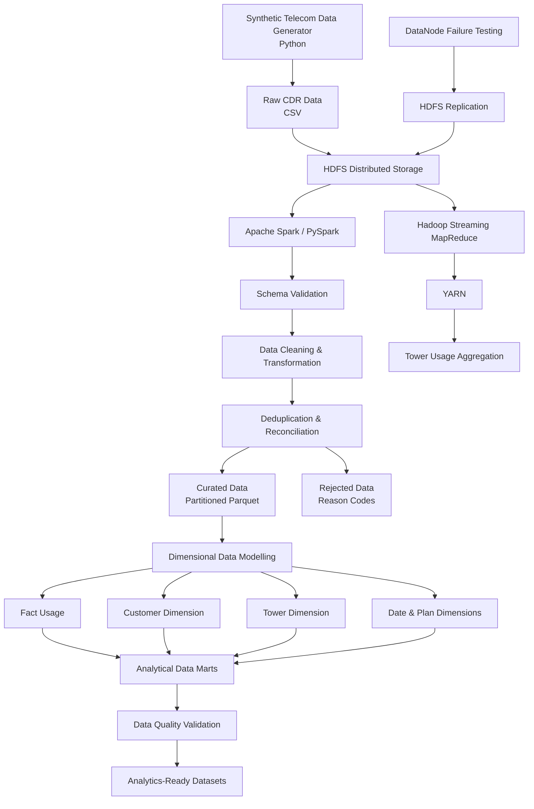

# Telecom Hadoop Platform
### End-to-End Big Data Engineering | Hadoop · HDFS · YARN · Apache Spark · PySpark · MapReduce · Parquet

An end-to-end Big Data engineering platform built to simulate telecom network usage analytics and demonstrate distributed data processing, fault-tolerant storage, data quality engineering, dimensional modelling, and performance optimisation.

The platform processes **3.03 million synthetic telecom Call Detail Records (CDRs)**, transforming raw data into validated, analytics-ready datasets using the Hadoop ecosystem.

It combines Hadoop Distributed File System (HDFS), YARN, Hadoop Streaming MapReduce, Apache Spark, PySpark, and Parquet to explore the engineering challenges involved in building reliable large-scale data platforms.

> **Dataset:** Synthetic telecom data generated specifically for this project. It does not contain real customer or telecom operator information.

---

## 1. Project Overview

Telecommunication networks generate enormous volumes of data through voice calls, SMS messages, and mobile data sessions.

Processing this data introduces several engineering challenges:

- Handling millions of incoming records.
- Detecting duplicates, missing values, and malformed records.
- Maintaining consistency across distributed storage.
- Processing large datasets efficiently.
- Handling node failures while maintaining data availability.
- Preserving historical customer information.
- Optimising storage formats and execution strategies.
- Ensuring data quality and reconciliation throughout the pipeline.

This project addresses these challenges by implementing a Big Data processing platform using the Hadoop ecosystem.

### Key Capabilities

| Area | Implementation |
|---|---|
| Data generation | Python-based synthetic CDR generator |
| Dataset size | 3.03 million records |
| Distributed storage | Hadoop Distributed File System (HDFS) |
| Resource management | YARN |
| Distributed batch processing | Hadoop Streaming MapReduce |
| Data processing | Apache Spark and PySpark |
| Storage optimisation | CSV and partitioned Parquet |
| Data modelling | Kimball Star Schema |
| Historical tracking | Slowly Changing Dimension Type 2 |
| Data quality | 12 automated validation checks |
| Fault tolerance | HDFS replication and DataNode failure testing |
| Performance engineering | File formats, partitioning, skew and shuffle optimisation |
| Infrastructure | Docker and Docker Compose |
| Testing | Pytest |

---

## 2. Results at a Glance

The platform was evaluated using 3.03 million generated telecom CDR records, alongside experiments covering distributed storage, fault tolerance, batch processing, and performance optimisation.

### Data Processing Results

| Metric | Result |
|---|---:|
| Raw CDR records | 3,030,000 |
| Successfully loaded records | 2,936,689 |
| Rejected records | 63,944 |
| Duplicates removed | 29,367 |
| Data reconciliation | Exact match |
| Data quality checks | 12/12 passed |
| Fact table records | 2,936,689 |
| Customer dimension records | 125,014 |
| Network tower dimension records | 500 |

### Distributed Systems Results

| Metric | Result |
|---|---:|
| HDFS DataNodes before failure experiment | 3 |
| Average replication factor after recovery | 2.0 |
| MapReduce input records | 505,001 |
| Map tasks | 2 |
| Reduce tasks | 1 |
| MapReduce execution time | 54.98 seconds |
| MapReduce aggregation groups | 501 |

### Performance Benchmark Results

| Experiment | Result |
|---|---:|
| Parquet storage compared with CSV | 3.37× smaller |
| ORC storage compared with CSV | 3.52× smaller |
| Parquet query execution compared with CSV | 5.23× faster |
| ORC query execution compared with CSV | 8.34× faster |
| Partition pruning improvement | 41.3% |
| Small-file compaction improvement | 64.0% |
| Best tested skew strategy | Broadcast join: 0.86s |

All benchmark execution times represent medians across three repetitions using Spark local execution with eight available CPU cores.

### Data Reconciliation

Every input record is accounted for through successful loading, rejection, or duplicate removal.

```text
Raw Records
    =
Successfully Loaded
    + Rejected
    + Duplicates Removed
```

```text
3,030,000
    =
2,936,689
    + 63,944
    + 29,367
```

The resulting total matches the generator's ground-truth manifest.

---

## 3. System Architecture

The platform follows a layered data engineering architecture, separating data generation, ingestion, distributed storage, transformation, dimensional modelling, and analytics.

### Architecture Diagram



### Core Components

**HDFS — Distributed Storage**

Stores raw and processed telecom datasets across multiple DataNodes. Replication provides fault tolerance and helps maintain data availability when a storage node fails.

**YARN — Resource Management**

Manages cluster resources and application execution for Hadoop workloads.

**Hadoop MapReduce — Distributed Batch Processing**

Executes a mapper and reducer workflow to aggregate telecom calls by network tower.

**Apache Spark — Data Processing**

Processes raw telecom records, performs transformations, builds dimensional models, and generates analytical datasets.

**Parquet — Analytical Storage**

Stores curated datasets in a columnar format to improve analytical query efficiency and reduce storage requirements.

---

## 4. Data Generation and Ingestion

### Synthetic CDR Generation

A Python-based generator creates telecom Call Detail Records representing:

- Voice calls.
- SMS messages.
- Mobile data sessions.
- Customer subscriptions.
- Network towers and regions.
- Call duration.
- Network latency.
- Usage volumes and associated charges.

The generator deliberately introduces data defects and distribution challenges to simulate realistic data engineering scenarios.

Examples include:

- Missing values.
- Invalid records.
- Duplicate CDR identifiers.
- Inconsistent fields.
- Uneven network traffic distribution.
- Degraded network tower behaviour.

A ground-truth manifest is generated alongside the dataset to support downstream reconciliation and validation.

### HDFS Ingestion

Raw CSV datasets are uploaded into HDFS.

The distributed filesystem provides:

- Block-based data storage.
- Replication across DataNodes.
- Fault tolerance.
- Distributed access to large datasets.
- Monitoring of storage health and block replication.

The project also includes experiments involving DataNode failure and block recovery.

---

## 5. Distributed Processing with Hadoop MapReduce

The project implements a Hadoop Streaming MapReduce workflow to calculate call volumes per network tower.

### Processing Workflow

**Mapper**

- Reads individual CDR records.
- Extracts the network tower identifier.
- Emits the tower identifier and corresponding call count.

**Shuffle and Sort**

- Groups records by tower identifier.
- Transfers intermediate mapper output to the reducer.

**Reducer**

- Aggregates the total calls for each tower.
- Produces the final tower-level usage summary.

### Execution Results

| Metric | Result |
|---|---:|
| Input records | 505,001 |
| Map tasks | 2 |
| Reduce tasks | 1 |
| Map output records | 505,000 |
| Aggregated output groups | 501 |
| Execution time | 54.98 seconds |

The distributed MapReduce results were compared against the local mapper/reducer implementation, with matching top tower aggregation results.

This experiment demonstrates the MapReduce execution model, distributed task execution, shuffle operations, and aggregation through YARN.

---

## 6. Data Processing with Apache Spark

Apache Spark and PySpark handle the primary transformation and analytical modelling workloads.

The processing pipeline transforms raw telecom records into structured and analytics-ready datasets.

### Data Cleaning and Transformation

The pipeline performs:

1. Schema validation and type enforcement.
2. Field standardisation.
3. Null and invalid-value detection.
4. Duplicate identification and removal.
5. Rejection of invalid records with reason codes.
6. Curated Parquet generation.
7. Processing audit and reconciliation.
8. Analytical data mart generation.

Invalid records are retained separately rather than silently discarded.

### Idempotent Processing

The pipeline supports safe reruns of the same processing scope through duplicate identification and partition overwrite.

Reprocessing the same batch should not introduce additional records into the final curated output.

Cross-batch deduplication of late-arriving records would require an additional transactional merge strategy.

### Execution Environment

The Spark jobs were successfully executed inside the Docker Spark Master container using local execution mode (`local[2]`) while reading from and writing to HDFS.

This verifies Spark processing against HDFS-resident data, but is distinct from execution across a multi-worker Spark standalone cluster.

---

## 7. Dimensional Data Modelling

The processed telecom data is transformed into a Kimball-style Star Schema to support analytical workloads.

### Fact Table

**`fact_usage`**

Grain: One record per call, SMS, or data session.

Contains usage-related measures and foreign keys referencing the associated dimensions.

Verified record count: **2,936,689**.

### Dimension Tables

| Dimension | Description | Verified Records |
|---|---|---:|
| `dim_customer` | Customer information and historical subscription tracking | 125,014 |
| `dim_tower` | Network tower and geographic information | 500 |
| `dim_date` | Calendar attributes, dates, years, quarters and months | Generated |
| `dim_plan` | Customer subscription and plan details | Generated |

### Slowly Changing Dimension Type 2

The `dim_customer` dimension implements Slowly Changing Dimension Type 2 (SCD Type 2) to preserve historical customer subscription information.

Instead of overwriting an existing customer record when their subscription changes, a new version is created.

The dimension maintains:

- `valid_from`: Start date of the record's validity.
- `valid_to`: End date of the record's validity.
- `is_current`: Identifies the currently active version.

This allows historical usage records to be associated with the customer information and subscription that were valid at the time of the activity.

### Analytical Data Marts

The platform also generates:

| Dataset | Purpose |
|---|---|
| `agg_region_daily` | Daily usage aggregation by region |
| `tower_health` | Network tower health and anomaly indicators |
| `churn_features` | Customer-level features for potential churn analysis |

The churn dataset contains analytical features and is not a trained churn prediction model.

---

## 8. Data Quality and Reliability

Data quality is integrated into the processing pipeline to ensure that curated datasets are complete, consistent, and reliable.

The platform implements 12 automated data-quality checks.

### Validation Areas

- Record completeness.
- Duplicate identification.
- Data validity.
- Referential integrity.
- Dimension key validation.
- SCD Type 2 interval consistency.
- Revenue reconciliation.
- Raw-to-curated reconciliation.
- Analytical dataset consistency.

### Rejected Records

Invalid records are separated from successfully processed records and retained with rejection reasons.

This provides traceability and makes it possible to investigate data-quality issues without losing the original information.

### Data Reconciliation

The pipeline reconciles raw, loaded, rejected, and duplicate records against the generator's ground-truth manifest.

### Data Quality Gate

All 12 implemented validation checks passed during the 3.03-million-record processing run.

---

## 9. HDFS Fault Tolerance and Recovery

A key part of the project is investigating how HDFS handles storage node failures.

The experiment uses multiple DataNodes and observes block replication before and after a simulated node failure.

### Experiment Workflow

1. Start the HDFS NameNode and three DataNodes.
2. Upload the raw telecom dataset.
3. Verify block distribution and replication.
4. Simulate a DataNode failure.
5. Monitor the failed node's detection.
6. Observe HDFS block recovery and replication.
7. Verify the final filesystem health.

### Observed Results

| Metric | Result |
|---|---|
| DataNodes before failure | 3 |
| Failed DataNode | Detected as dead |
| Failure detection | Approximately 10.5 minutes |
| Filesystem health after recovery | HEALTHY |
| Under-replicated blocks after recovery | 0 |
| Average replication factor | 2.0 |

The experiment demonstrates HDFS fault tolerance and its ability to maintain healthy replicated storage after a DataNode failure.

---

## 10. Performance Engineering and Benchmarking

The platform includes a benchmarking suite designed to evaluate storage formats, partitioning strategies, small-file overhead, and join optimisation techniques.

### Benchmark Environment

| Parameter | Configuration |
|---|---|
| Dataset size | 2,936,689 rows |
| Spark master | `local[*]` |
| Available cores | 8 |
| Repetitions | 3 |
| Reported measurement | Median execution time |

### 10.1 Storage Format Comparison

The benchmark compares CSV, Parquet, and ORC using the same analytical operation: filtering and grouping by three of the twelve available columns.

| Format | Execution Time | Storage Size | Files |
|---|---:|---:|---:|
| CSV | 3.92s | 338.5 MB | 4 |
| Parquet | 0.75s | 100.4 MB | 4 |
| ORC | 0.47s | 96.2 MB | 4 |

**Key observations:**

- Parquet reduced storage consumption by approximately 70.3% compared with CSV.
- Parquet completed the tested query approximately 5.23× faster than CSV.
- ORC achieved the lowest storage footprint and fastest execution time in this experiment.
- ORC completed the tested query approximately 8.34× faster than CSV.
- Both columnar formats significantly outperformed CSV for the tested analytical workload.

This demonstrates the benefits of columnar storage, compression, and efficient analytical reads.

### 10.2 Partition Pruning

This experiment evaluates whether partitioning data by `call_date` improves query performance when filtering for a single day.

The benchmark uses the same one-day filter: `2026-09-01`.

| Configuration | Execution Time | Storage Size | Files |
|---|---:|---:|---:|
| Unpartitioned | 0.75s | 101.6 MB | 12 |
| Partitioned by `call_date` | 0.44s | 106.6 MB | 231 |

**Key observations:**

- Partitioning reduced execution time from 0.75 seconds to 0.44 seconds.
- This represents approximately a 41.3% reduction in execution time.
- The partitioned dataset contained more files due to date-based organisation.
- Storage increased slightly from 101.6 MB to 106.6 MB.

The experiment demonstrates that partition pruning can improve selective analytical queries, although partitioning introduces additional file-management overhead.

### 10.3 Small-File Problem and Compaction

A common challenge in distributed data platforms is the creation of numerous small files.

This experiment evaluates the impact of compacting 1,000 small files into eight larger files.

| Configuration | Execution Time | Storage Size | Files |
|---|---:|---:|---:|
| 1,000 small files | 3.47s | 122.5 MB | 1,000 |
| 8 compacted files | 1.25s | 108.1 MB | 8 |

**Key observations:**

- File count decreased from 1,000 to 8.
- Execution time improved from 3.47 seconds to 1.25 seconds.
- Processing time decreased by approximately 64%.
- Storage consumption decreased by approximately 11.8%.

This experiment demonstrates why file compaction is important in analytical data lakes: excessive small files increase file listing, metadata, and task scheduling overhead.

### 10.4 Data Skew and Join Optimisation

Data skew occurs when certain keys contain significantly more records than others, resulting in uneven data distribution across processing tasks.

The benchmark deliberately introduces uneven network tower traffic, with the hottest tower accounting for 19.2% of dataset rows.

Four join strategies were evaluated.

| Join Strategy | Execution Time | Observation |
|---|---:|---|
| Sort-merge join, AQE disabled | 5.74s | Baseline |
| Sort-merge join, AQE skew handling | 2.83s | Oversized partitions split |
| Broadcast join | 0.86s | Small side sent to every executor |
| Salted join (K=8), AQE disabled | 2.59s | Hot key distributed across K partitions |

**Key observations:**

- Broadcast join achieved the best execution time at 0.86 seconds.
- AQE skew handling reduced sort-merge execution time by approximately 50.7%.
- Salting reduced execution time by approximately 54.9% compared with the baseline.
- Broadcast joins avoided shuffling the larger dataset by distributing the smaller join side.
- Salting distributed heavily concentrated keys across eight partitions.

The results demonstrate that join strategy selection and skew mitigation can significantly affect processing performance.

Broadcast joins are particularly effective when one side of a join is sufficiently small to be safely replicated to the executors.

### 10.5 Performance Summary

| Experiment | Main Finding |
|---|---|
| CSV vs Parquet | Parquet was 3.37× smaller and 5.23× faster |
| CSV vs ORC | ORC was 3.52× smaller and 8.34× faster |
| Partition pruning | Reduced execution time by approximately 41.3% |
| Small-file compaction | Reduced execution time by approximately 64% |
| AQE skew handling | Improved baseline execution time by approximately 50.7% |
| Broadcast join | Fastest tested strategy at 0.86s |
| Join salting | Improved baseline execution time by approximately 54.9% |

**Benchmark scope:** These measurements were obtained using Spark local execution (`local[*]`) with eight available CPU cores. They represent controlled local performance experiments, not multi-node distributed cluster benchmarks. Results are workload- and environment-dependent.

---

## 11. Technology Stack

| Category | Technologies |
|---|---|
| Programming | Python |
| Distributed Storage | Hadoop HDFS |
| Resource Management | YARN |
| Batch Processing | Hadoop MapReduce, Hadoop Streaming |
| Distributed Data Processing | Apache Spark, PySpark |
| Storage Formats | CSV, Parquet, ORC |
| Data Modelling | Kimball Star Schema, SCD Type 2 |
| Data Quality | Automated validation and reconciliation |
| Infrastructure | Docker, Docker Compose |
| Testing | Pytest |
| Build Automation | Makefile |
| Version Control | Git, GitHub |

---

## 12. Repository Structure

```text
telecom-hadoop-platform/
│
├── benchmarks/
│   └── Performance experiments and benchmark results
│
├── data/
│   └── Generated telecom datasets and manifests
│
├── docker/
│   ├── docker-compose.yml
│   └── Hadoop and Spark configurations
│
├── generator/
│   └── Synthetic telecom CDR generator
│
├── jobs/
│   └── Spark data processing and transformation jobs
│
├── sql/
│   └── SQL scripts and analytical queries
│
├── tests/
│   └── Automated pipeline tests
│
├── .gitignore
├── Makefile
├── README.md
├── requirements.txt
├── results.csv
└── results.md
```

---

## 13. Getting Started

### Prerequisites

- Python 3.10 or higher.
- Java compatible with the selected Hadoop and Spark versions.
- Docker.
- Docker Compose.
- Git.
- Make.

### 1. Clone the Repository

```bash
git clone https://github.com/ThejaswiniSunil/telecom-hadoop-platform.git

cd telecom-hadoop-platform
```

### 2. Install Dependencies

```bash
make install
```

### 3. Generate Telecom Data

Generate one million records:

```bash
make data ROWS=1000000
```

For the full dataset:

```bash
make data ROWS=3030000
```

### 4. Run the Local Processing Pipeline

```bash
make pipeline
```

### 5. Run Automated Tests

```bash
make test
```

### 6. Start the Docker Environment

```bash
docker compose -f docker/docker-compose.yml up -d
```

### 7. Inspect Running Containers

```bash
docker compose -f docker/docker-compose.yml ps
```

### 8. Access the Web Interfaces

Once the corresponding services are running and their ports are exposed:

| Component | Local URL |
|---|---|
| HDFS NameNode | http://localhost:9870 |
| YARN ResourceManager | http://localhost:8088 |
| Spark Master | http://localhost:8080 |
| Spark Application UI | http://localhost:4040 |

The Spark Application UI is available while a Spark application is running.

---

## 14. Implementation Verification

The following table distinguishes successfully executed components from functionality that has not yet been verified.

| Component | Status |
|---|---|
| Synthetic CDR data generation | Verified |
| 3.03M record processing | Verified |
| Data reconciliation | Verified |
| Spark cleaning and transformation | Executed against HDFS |
| Dimensional data modelling | Verified |
| Analytical data marts | Verified |
| Automated data-quality checks | 12/12 passed |
| HDFS NameNode | Verified |
| HDFS DataNodes | Verified |
| HDFS replication | Verified |
| DataNode failure and recovery | Verified |
| YARN ResourceManager | Verified |
| YARN NodeManager | Verified |
| Hadoop Streaming MapReduce | Successfully executed on YARN |
| Spark standalone multi-worker execution | Pending verification |

**Execution distinction:** Spark was executed in local mode (`local[2]`) inside the Docker environment against HDFS data. Hadoop Streaming MapReduce was separately submitted to YARN and completed successfully. A distributed multi-worker Spark execution has not yet been verified.

---

## 15. Production Architecture Mapping

The technologies explored in this project have counterparts in modern cloud-based data engineering architectures.

| Project Technology | Enterprise / Cloud Equivalent |
|---|---|
| Hadoop HDFS | Amazon S3, Azure Data Lake Storage Gen2, Google Cloud Storage |
| YARN | Managed cluster resource orchestration |
| Apache Spark | Databricks, Amazon EMR, Azure Synapse Spark |
| Parquet | Common analytical storage format across cloud data lakes |
| Hadoop MapReduce | Distributed batch processing workloads |
| Docker | Containerised development and deployment environments |

These are architectural comparisons rather than direct one-to-one replacements.

The project provides a foundation for extending the architecture towards cloud-based data lakes and lakehouse platforms.

---

## 16. Future Improvements

Potential extensions include:

- Implementing Apache Airflow for workflow orchestration.
- Deploying Spark jobs across multiple worker nodes.
- Introducing Delta Lake or Apache Iceberg for transactional data processing.
- Implementing incremental ingestion and merge operations.
- Supporting late-arriving records.
- Adding automated retries and failure recovery.
- Implementing pipeline monitoring and alerting.
- Integrating interactive BI dashboards.
- Deploying the architecture on a managed cloud platform.
- Extending network anomaly detection with machine learning.

---

## 17. Project Objective

The objective of this project was to explore the engineering principles behind building reliable Big Data processing platforms.

Rather than focusing solely on data transformations, the implementation covers the complete data lifecycle:

**Generation → Ingestion → Distributed Storage → Processing → Data Quality → Dimensional Modelling → Analytics → Performance Optimisation**

The project demonstrates practical experience with Hadoop distributed storage, YARN resource management, MapReduce execution, Spark-based data processing, fault tolerance, data modelling, and large-scale data quality engineering.

It highlights the importance of building data pipelines that are not only capable of processing large datasets, but are also reliable, measurable, and maintainable.

---

**Author:** Thejaswini Sunil

**Focus Areas:** Big Data Engineering · Distributed Systems · Data Pipelines · Data Quality · Data Modelling · Performance Engineering

**Technologies:** Python · Hadoop · HDFS · YARN · Apache Spark · PySpark · MapReduce · Parquet · ORC · Docker · SQL · Pytest

